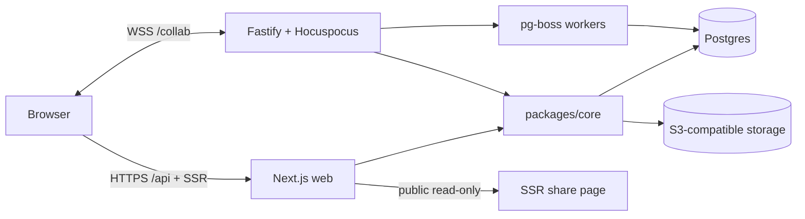

# Inkwell — Engineering Plan

## Confirmed configuration

- App name: Inkwell
- Scope: v1 web app, multi-user, one deployable instance
- Delivery: continuous by milestone, commit at every acceptance gate, honest checkpoint reports
- Web: Next.js 16 App Router (SSR share pages, HTTP API route handlers)
- Realtime/jobs: Fastify 5 + Hocuspocus 4 over `crossws` + pg-boss
- Auth: email/password (Argon2id, cookie sessions); OAuth deferred
- Database: PostgreSQL 17 + Drizzle ORM; search through PostgreSQL full-text
- Files: S3-compatible storage (RustFS locally; MinIO images are no longer pullable)
- Tests: Vitest, Playwright, axe, Lighthouse

## Architecture



- `apps/web` owns the UI, server-rendered public share pages, and the HTTP API.
- `apps/server` owns WebSocket collaboration, presence, Yjs persistence, and background jobs.
- `packages/core` is the only layer allowed to execute domain queries. It owns the central authorization layer.
- `packages/db` owns the Drizzle schema, migrations, and connection pooling.
- `packages/shared` owns isomorphic contracts, zod schemas, the Tiptap extension factory, and Yjs conversion utilities.

### Repository layout

```text
.
├── apps/
│   ├── web/                  Next.js App Router
│   └── server/               Fastify + Hocuspocus + pg-boss workers
├── packages/
│   ├── shared/               contracts, block schema, editor/Yjs utilities
│   ├── db/                   schema, migrations, database client
│   └── core/                 auth, authz, domain services, storage, jobs
├── scripts/                  bootstrap, seed, backup/restore
├── infra/                    Caddy, production Dockerfiles
├── docs/screenshots/
├── .github/workflows/ci.yml
├── docker-compose.yml
├── docker-compose.prod.yml
├── PLAN.md
├── PROGRESS.md
├── DECISIONS.md
└── README.md
```

## Core design

### Content model

- One `Y.Doc` per page.
- Container metadata and layout live in a `Y.Map`; ink strokes live in a `Y.Array`.
- Each container's block tree is a named `Y.XmlFragment` (`container:<id>`), bound directly to a Tiptap editor through the Collaboration extension's `fragment` option.
- A Flow page is one pinned full-width container. A Canvas page has N free-positioned containers.
- Flow → Canvas keeps the fragment and unpins its container. Canvas → Flow deep-clones fragments into the pinned fragment in spatial reading order inside one transaction. The round trip is covered by an automated fixture test.
- Databases are pages; database rows are pages too, so a row can itself be a Flow or Canvas page.

### Persistence and jobs

- `page_docs` stores the latest encoded Yjs state.
- `page_updates` stores batched incremental updates.
- `page_versions` stores periodic snapshots and explicit checkpoints.
- Storing a document enqueues a debounced pg-boss indexing job.
- The indexer derives `page_search`, `page_links`, and `todo_index` from the Yjs state.
- Version restore is a pg-boss job handled by the realtime server through a direct Hocuspocus connection.

### Authorization

- `packages/core/authz.ts` is the single authorization layer.
- Every domain service takes an authenticated actor and enforces workspace/page roles.
- Next route handlers never query workspace data directly.
- Hocuspocus authenticates each document through the same layer; viewers connect read-only.
- Coverage for the authorization layer is a release gate (≥90%).

### Search

- PostgreSQL `tsvector` with GIN, plus trigram indexes for titles.
- Index includes title, block text, tags, and database property values.
- Search runs asynchronously from collaboration writes; the UI reflects the short indexing delay.

### Storage

- RustFS locally, any S3-compatible service in production.
- Buckets are private. Downloads are authorized and proxied; public share pages use token-scoped file routes.
- Uploads validate declared MIME, magic bytes, and size; keys are random.

## Milestones

- [x] **M0 Foundations** — monorepo, strict TS, lint/format, env validation, compose, migrations, health, CI, docs skeleton.
- [x] **M1 Auth and workspaces** — sign-up/in/out, reset, workspaces, invites, roles, central authz, CSRF, rate limits.
- [ ] **M2 Hierarchy** — notebooks, colored sections, nested pages, drag/drop, rename, icon/cover, favorites, trash/restore.
- [ ] **M3 Flow editor** — block suite, slash menu, markdown shortcuts, drag handles, page links, mentions, uploads, sanitization.
- [ ] **M4 Collaboration** — presence, IndexedDB offline, reconnect merge, version history and restore.
- [ ] **M5 Canvas and ink** — pan/zoom, containers, culling, media drop, pen/highlighter/eraser, shapes, lossless conversion.
- [ ] **M6 Databases** — properties, relations, rollups, formulas, five views, filters/sorts/groups, saved views, inline databases.
- [ ] **M7 Search and navigation** — command palette, recents, backlinks, outline, tags, tag summary, 5k-page performance.
- [ ] **M8 Import/export/share** — Markdown, HTML, PDF, Notion ZIP import, public share links with revocation.
- [ ] **M9 Templates and polish** — templates, comments, inbox, shortcuts, themes, tablet, PWA, accessibility.
- [ ] **M10 Hardening** — security/perf/a11y audits, backups, seed, production images, final report.

## Per-milestone loop

1. Implement the milestone.
2. Write or extend unit and integration tests.
3. Run typecheck and lint.
4. Run the stack and exercise it with Playwright in a real browser.
5. Fix failures; record honest gaps.
6. Update `PROGRESS.md` and `DECISIONS.md`.
7. Commit with Conventional Commits.

Functional, security, and data-integrity acceptance criteria are hard gates. If a performance or accessibility target cannot be met after optimization, work stops and the shortfall is reported rather than hidden.

## Verification

```text
pnpm typecheck
pnpm lint
pnpm test
pnpm test:integration
pnpm e2e
pnpm build
pnpm audit --prod
```

Additional gates:

- Authorization coverage ≥90%.
- Two-client collaboration suite repeated 10 times without flakes.
- 5k-page seeded search benchmark <300 ms.
- Bundle-size and 2,000-block page-open measurements recorded.
- axe WCAG 2.2 AA checks and Lighthouse PWA audit.

## Risks and mitigations

| Risk                                         | Mitigation                                                               |
| -------------------------------------------- | ------------------------------------------------------------------------ |
| v1 scope is multi-week                       | Milestone gates, resumable docs, no unverified claims                    |
| Multi-fragment Yjs editing and conversion    | Validate with fixture tests before building the canvas UI                |
| WebSocket cookies across origins             | Same-host cookie, Caddy single origin in production, explicit auth tests |
| Search freshness under live edits            | Debounced jobs, e2e polling, visible indexing state                      |
| Version restore while a document is open     | Direct connection plus forced reload                                     |
| Next bundle and 2k-block performance targets | Dynamic imports, measurement scripts, honest reporting                   |
| Docker/Playwright flakiness on Windows       | Chromium only, retries, repeat collaboration suite                       |
| Dependency major-version churn               | Pin versions, thin wrappers, upgrade deliberately                        |
