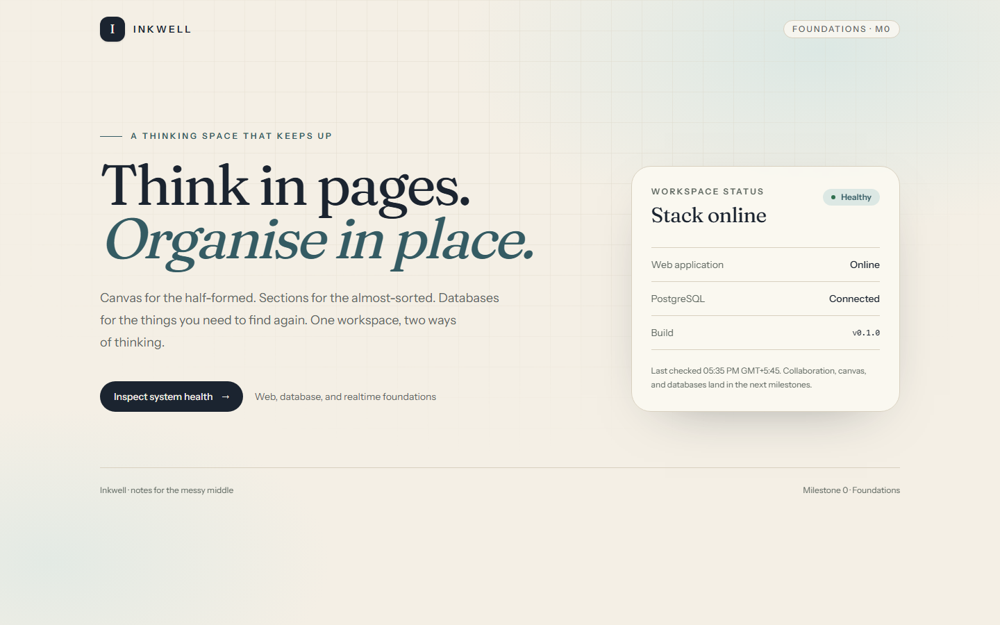
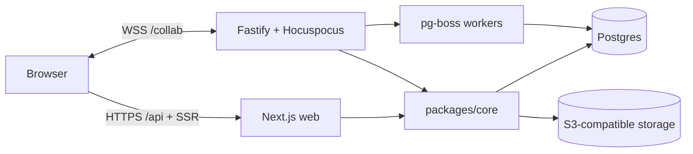

# Inkwell

Inkwell is a note-taking workspace that pairs OneNote-style free-form thinking with Notion-style structured knowledge. Pages are built from containers that hold a collaborative block tree, so the same content can live as a focused document or on an infinite canvas.

**Status:** Milestone 0 complete — foundations. See `PROGRESS.md` for the honest state of every milestone.



## Stack

- Next.js 16 App Router, React 19, Tailwind CSS 4
- Tiptap 3 + Yjs + Hocuspocus (collaboration)
- Fastify 5 realtime/jobs service, pg-boss workers
- PostgreSQL 17 + Drizzle ORM
- S3-compatible storage (RustFS locally) + Mailpit in development
- TypeScript, Vitest, Playwright, ESLint, Prettier

## Quick start

Requirements: Node 22.12+, pnpm 10, Docker with Compose.

```bash
pnpm bootstrap
docker compose up -d
pnpm dev
```

`pnpm dev` creates `.env` from `.env.example` when missing, applies migrations, then starts:

- Web: http://localhost:3000
- Realtime service: http://localhost:1234
- Object storage console: http://localhost:9001 (`minioadmin` / `minioadmin`)
- Mailpit: http://localhost:8025

The health endpoint is at http://localhost:3000/api/health.

## Scripts

| Command                 | Purpose                                        |
| ----------------------- | ---------------------------------------------- |
| `pnpm bootstrap`        | Create `.env` from `.env.example` when missing |
| `pnpm dev`              | Migrate, then run web and realtime services    |
| `pnpm build`            | Build Next.js and the realtime server          |
| `pnpm typecheck`        | Type-check every workspace package             |
| `pnpm lint`             | ESLint across the repository                   |
| `pnpm test`             | Unit tests                                     |
| `pnpm test:integration` | Integration tests (requires Docker services)   |
| `pnpm e2e`              | Playwright browser tests                       |
| `pnpm db:generate`      | Generate a migration from schema changes       |
| `pnpm db:migrate`       | Apply migrations                               |
| `pnpm seed`             | Load the demo workspace                        |
| `pnpm check`            | Typecheck, lint, and unit tests                |

## Architecture



- `apps/web` — UI, HTTP API, server-rendered public share pages.
- `apps/server` — WebSocket collaboration, Yjs persistence, background workers.
- `packages/core` — domain services and the central authorization layer.
- `packages/db` — Drizzle schema, migrations, connection pool.
- Local S3 runs on RustFS because the MinIO images are no longer publicly pullable; production uses any S3-compatible service.
- `packages/shared` — isomorphic contracts, zod schemas, editor utilities.

Every workspace-scoped operation goes through `packages/core`; route handlers stay thin. See `PLAN.md` for the content model and milestone plan, and `DECISIONS.md` for architecture records.

## Environment

All variables are validated with zod at startup. Copy `.env.example` to `.env` for local development. Never commit `.env`.

| Variable                 | Purpose                                      |
| ------------------------ | -------------------------------------------- |
| `APP_URL`                | Public web origin                            |
| `DATABASE_URL`           | PostgreSQL connection string                 |
| `SESSION_SECRET`         | Session/cookie signing material (32+ chars)  |
| `INTERNAL_API_SECRET`    | Signed internal web-to-realtime calls        |
| `COLLAB_PORT`            | Realtime service port                        |
| `NEXT_PUBLIC_COLLAB_URL` | WebSocket URL used by the browser            |
| `S3_*`                   | S3-compatible storage credentials and bucket |
| `SMTP_*`                 | Development mail delivery                    |

## Testing

Unit tests run without infrastructure. Playwright and integration tests require PostgreSQL and object storage from `docker compose up -d`.

```bash
pnpm test
pnpm test:integration
pnpm e2e
```

## Deployment, backups, and screenshots

Documented in Milestone 10. Production will use two images (Next.js and realtime) behind Caddy, with PostgreSQL and S3-compatible storage managed separately.

## Known gaps

See `PROGRESS.md`. At Milestone 0 the application has authentication, editors, canvas, databases, search, and sharing still ahead.
